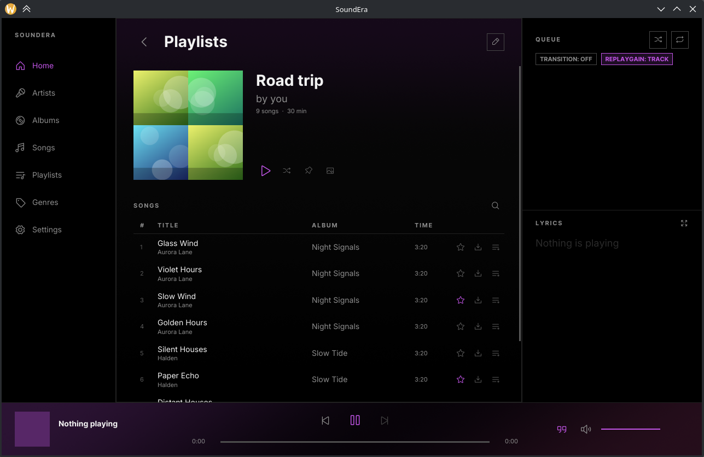
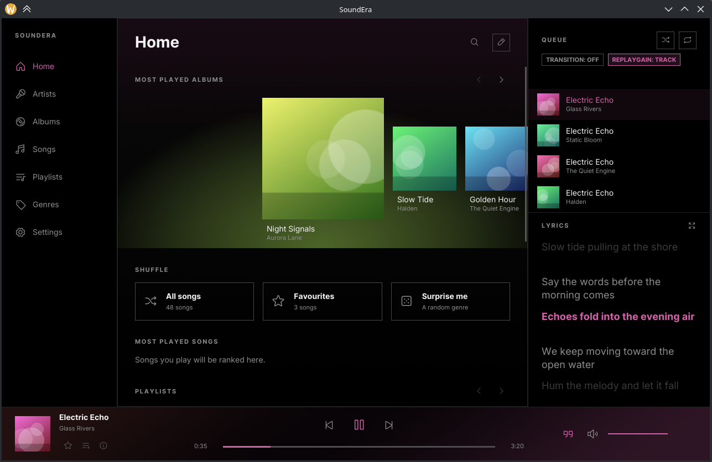
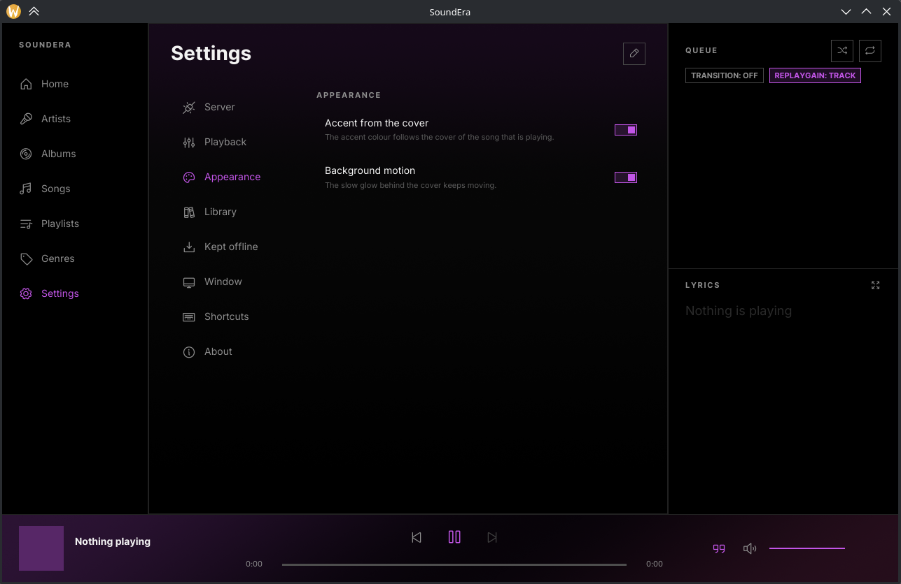

# SoundEra

A dark, fast and fully customisable desktop music player for your own music server.
SoundEra connects to any OpenSubsonic-compatible server (such as Navidrome), streams or keeps your music offline, and puts the things you play most right on the front page.

## Highlights

- **Your server, your music.** Works with Navidrome and other OpenSubsonic servers. Browse artists, albums, songs, genres and playlists, search the whole library, star favourites and edit playlists.
- **Home that learns what you play.** Most played albums and songs, playlists, artists, and one-click shuffles: all songs, favourites, or a random genre.
- **Synced lyrics** that follow the song line by line, in the queue panel or full screen.
- **Gapless playback** with optional crossfade and ReplayGain loudness levelling, with a volume boost when you need it.
- **Offline when you want it.** Keep whole albums or single songs on your computer and play them without the server.
- **Make it yours.** Edit Mode lets you move, resize, pin and remove every panel; the layout, the shortcuts and the Home sections are all rearrangeable.
- **Colour from the cover.** The accent colour and the glow follow the artwork of the song that is playing.
- **Keyboard first.** Every shortcut can be changed, several keys can do the same thing, and a clash is shown to you instead of silently overwritten.
- **Private by design.** No accounts, no tracking. Your password stays in your system's keyring, and the program only talks to your server and, to look for updates, to this page.

## Screenshots

| | |
|---|---|
|  |  |
|  |  |
|  |  |

The pictures above are placeholders from a demo library.

## Download

Get the newest version from the [Releases](../../releases/latest) page.

| System | File | How |
|---|---|---|
| Linux (x86_64) | `SoundEra-<version>-x86_64.AppImage` | Make it executable (`chmod +x SoundEra-*.AppImage`) and run it. If your system lacks FUSE, run it with `--appimage-extract-and-run`. |
| Windows 10 / 11 (64-bit) | `SoundEra-<version>-Setup.exe` | Run the installer. It installs for your user only and needs no administrator rights. |

The Windows version is new and has had less testing than the Linux one; media-key integration on Windows is not there yet.

## First start

1. Open **Settings > Server** and type your server address, user name and password.
2. Press **Connect**, then **Sync library** on Home.
3. Press **Edit Mode** (the pencil) to arrange the window the way you like it.

An address that starts with `http://` instead of `https://` is not encrypted, and SoundEra warns you when it is used outside your own network.

## Updates

SoundEra looks for a new version when it starts (this can be switched off under **Settings > About**). An update is installed only when you press **Update**, and only after its digital signature has been checked, so a changed or swapped file is refused.

## What is in this repository

Only the finished programs and their signatures. The source code is not published.

## Licence

Copyright (c) 2026 ennuiLife. All rights reserved.
SoundEra includes open-source components; their licences are listed in [THIRD-PARTY-NOTICES.md](THIRD-PARTY-NOTICES.md).
