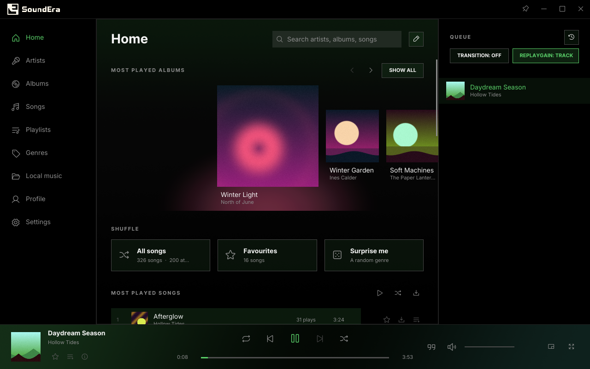
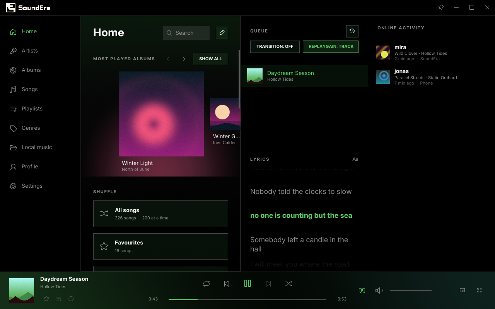
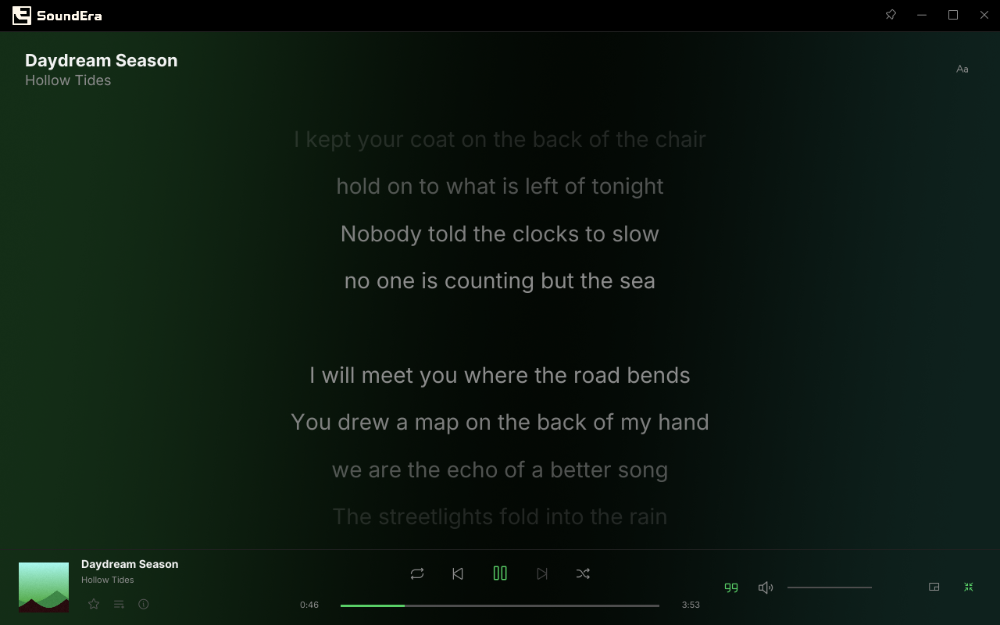
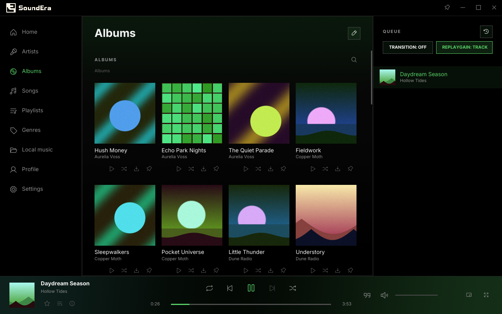
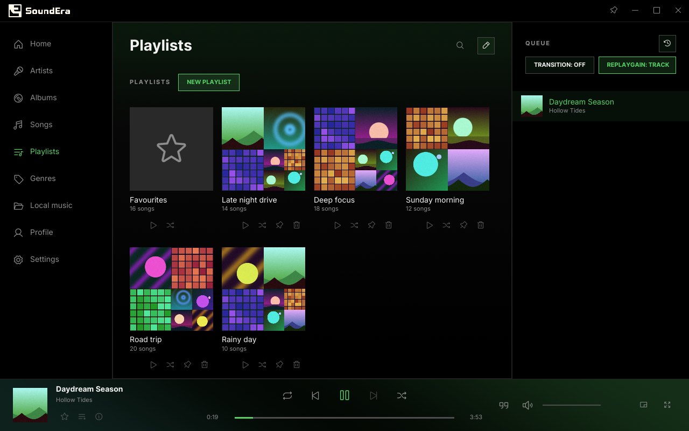
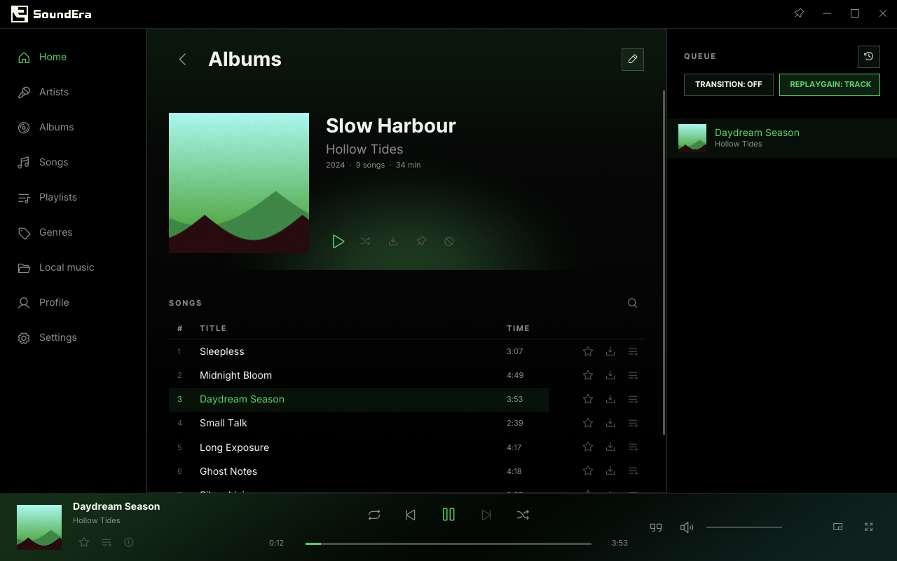
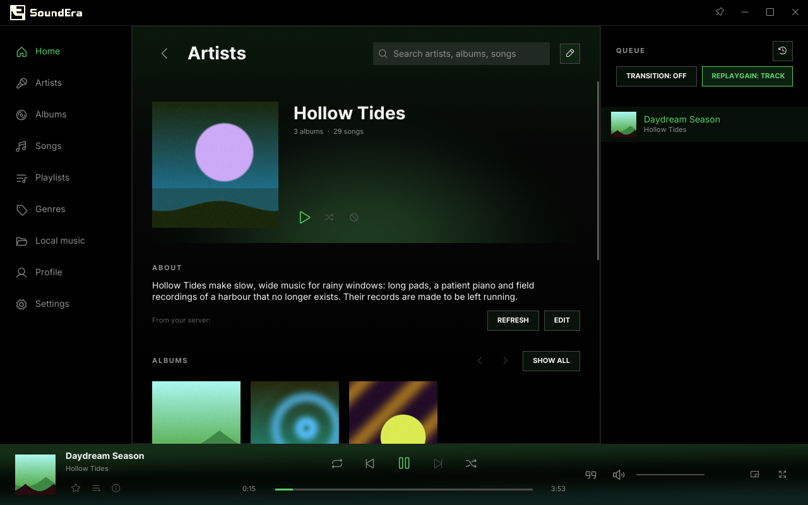
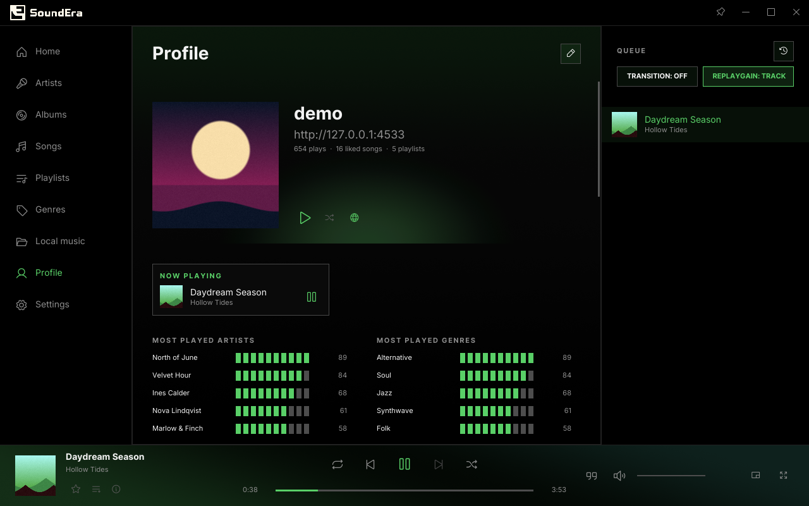

<h1 align="center">SoundEra</h1>

  <b>A desktop music player for your own music server, built around the music you actually play.</b> 
  Dark, fast, synced lyrics with karaoke, offline listening, and a window you can rebuild piece by piece.

  <a href="../../releases/latest"><b>Download</b></a> ·
  <a href="#what-makes-it-different">Features</a> ·
  <a href="#first-start">First start</a> ·
  <a href="#privacy-and-security">Privacy and security</a>

SoundEra connects to any **OpenSubsonic-compatible server** (Navidrome, for example) and turns it into a player that
feels like one piece: the colour of the song that is playing runs through the whole window, the lyrics follow the
singer, and every part of the layout is yours to move, resize or throw away. It is for people who keep their own
music and want a player that is as careful as their library.

*Every picture on this page comes from SoundEra itself, running against a made-up demo library (invented artists,
generated covers, synthesised audio). No real music or artwork is shown.*

## What makes it different

### Your window, your layout

Every part of SoundEra is a **widget**: Navigation, Page, Queue, Lyrics, Player bar, Visualizer, Equalizer, Online
activity. In **Edit Mode** you drag them where you want them, resize them, pin them, stack two in one column and delete
the ones you don't need. While you drag, a single box shows exactly where the widget will land, and everything
slides smoothly into place. Undo and redo cover every change, and you can keep several layouts.

### Lyrics that follow the singer

Synced lyrics scroll with the song, line by line. Switch on **karaoke** and the line being sung fills with the
accent colour as it is sung, word by word when the lyrics carry word times. For lyrics that only have line times,
**SoundEra Karaoke** listens to the song itself and estimates where the voice is, so the highlight does not race
ahead during an instrumental break. Click any line to jump there. Open the lyrics full screen, with the queue beside
them if you like, or in a small always-on-top window that shrinks down to just the song and its buttons.

Lyrics your server doesn't have can be fetched from [LRCLIB](https://lrclib.net) (off until you switch it on), and
you can **search inside lyrics**: find the song by a line you remember, and a click plays it from that line.

### Home that learns what you play

Most played albums and songs, recently added, your playlists and artists, and one-click shuffles for *all songs*,
*favourites* or a *random genre*. Rearrange, pin or hide every Home section. Songs, albums and whole artists you
never want suggested can be **avoided**: they stay in your library but never show up on Home or in a shuffle.

### Made for big libraries

- Search that works in every language and script: accents, case, Arabic marks, Hebrew points, Chinese, Japanese and
  Thai are all handled, and results are ranked, not just listed.
- **Drag a song onto a playlist** from any list, the queue or the player bar. Drop it on an empty part of Home to
  start a new playlist with it. Playlists get a mosaic cover made from their songs, or a picture you choose.

- Artists with several credits link to every artist separately. Back, forward and Esc take you through the pages you
  visited, with scroll position and search restored.
- Rate songs from one to five stars, star favourites, see the full song info (format, bit rate, plays here, which
  playlists hold it).

### Offline when you want it

Keep a whole album or a single song on your computer and play it without the server. Pick a folder
of **local music** and play files that were never on a server at all. A cache with a size limit that you choose looks
after everything else, and what you keep is never thrown out.

### Sound

- **Gapless playback**, optional crossfade and **ReplayGain** loudness levelling.
- A ten-band **equalizer** with profiles (Flat, Bass boost, Vocal, Rock and more, and your own), and a **volume boost**
  for quiet recordings. The engine lowers the level for you so loud songs don't clip.
- An audio **visualizer** widget (bars or a steady wave) that draws what is really playing.
- If the headphones are unplugged the music pauses, and SoundEra tells you. It picks up where it left off on the
  next device.

### Profile and online activity

Your **Profile** shows your plays, your liked songs and your most played artists and genres. If you switch on
**Online activity** (on by default, and one switch to turn it off), other people on your server can see what you are
listening to, and you can see what they play and play along. It uses only what a stock OpenSubsonic server already
offers, so nothing new has to be installed on the server.

### In your language

English, Türkçe, Deutsch, Español, Français, Português, Русский, العربية and Azərbaycanca are translated through the
whole program, and more Turkic languages are on the way (Kazakh, Uzbek, Turkmen, Kyrgyz, Tatar, Uyghur and others are
partly filled in). Right-to-left languages mirror the whole window. The language list shows how much of the program
each language covers.

### The small things

- Colour from the cover, with a slow glow behind it that you can turn off.
- The window has its **own title bar**, with a "keep on top" pin, and works with the system tray and, on Windows, the
  taskbar preview buttons and media keys.
- Zoom from 60% to 200%, with Ctrl and plus / minus, and windows bigger than Full HD grow by themselves.
- **Every shortcut can be changed**, several keys can do the same thing, and a clash is shown instead of silently
  overwritten.
- It works **without a server** too: choose "I'll add a server later" and play your local music.

## Privacy and security

SoundEra is made to be quiet.

- **No accounts, no tracking, no analytics.** The program talks to your server, and nothing else unless you switch it
  on. Each online source (biographies from Wikipedia, artist pictures from TheAudioDB, lyrics from LRCLIB) has its own
  switch in **Settings > Online**, and the row says in one line what is sent.
- **Your password stays in the system keyring** (Secret Service, KDE Wallet or Windows Credential Manager), never in a
  settings file. Requests use a token, not the password, and web addresses and tokens are removed from the error logs
  you can copy.
- **Signed updates.** Every release file is signed with [minisign](https://jedisct1.github.io/minisign/), and
  SoundEra installs only an update whose signature is valid for that exact version. You can check a download yourself
  with the public key in [SECURITY.md](SECURITY.md).
- Data from a server or a file is treated as hostile: pictures and downloads are size-limited and file names are
  cleaned.

Found a weakness? Please read the [security policy](SECURITY.md) and report it privately.

## Download

Get the newest version from the [Releases](../../releases/latest) page.

| System | File | How |
|---|---|---|
| Linux (x86_64) | `SoundEra-<version>-x86_64.AppImage` | Make it executable (`chmod +x SoundEra-*.AppImage`) and run it. Without FUSE, run it with `--appimage-extract-and-run`. |
| Linux (x86_64) | `SoundEra-<version>-linux-x86_64.tar.gz` | Unpack it and run `install.sh` (for your user, in `~/.local`) or `install.sh --system`. `uninstall.sh` removes it. |
| Windows 10 / 11 (64-bit) | `SoundEra-<version>-Setup.exe` | Run the installer. It installs for your user only and needs no administrator rights. |

The Windows version has had less testing than the Linux one.

## First start

1. Open SoundEra and type your server address, user name and password, then press **Connect**. (No server yet? Press
   **I'll add a server later** and choose a music folder under **Local music**.)
2. Under **Make it yours** pick your language, zoom and the options you like.
3. Press **Sync library** on Home, then press the pencil (**Edit Mode**) to arrange the window your way.

An address that starts with `http://` instead of `https://` is not encrypted, and SoundEra warns you when it is used
outside your own network.

## Updates

SoundEra looks for a new version when it starts (you can change this under **Settings > Updates**, where the full
changelog is too). An update is downloaded and installed only after its signature has been checked, and you decide
when to restart.

## What is in this repository

Only the finished programs and their signatures, plus this page. The source code is not published.

## Licence

Copyright (c) 2026 ennuiLife. All rights reserved.
SoundEra includes open-source components; their licences are listed in [THIRD-PARTY-NOTICES.md](THIRD-PARTY-NOTICES.md).
